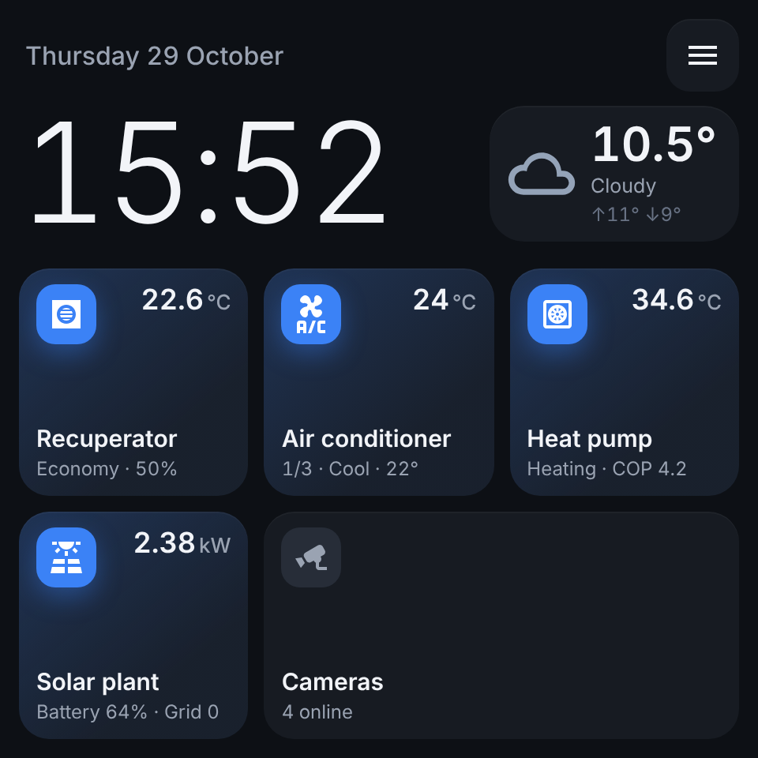
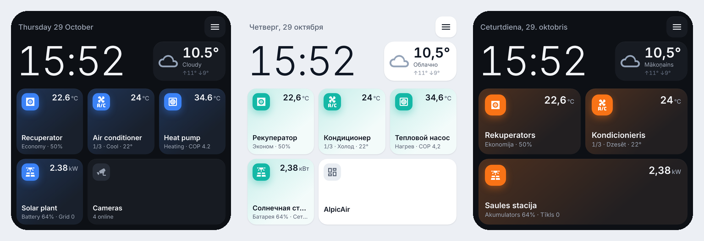
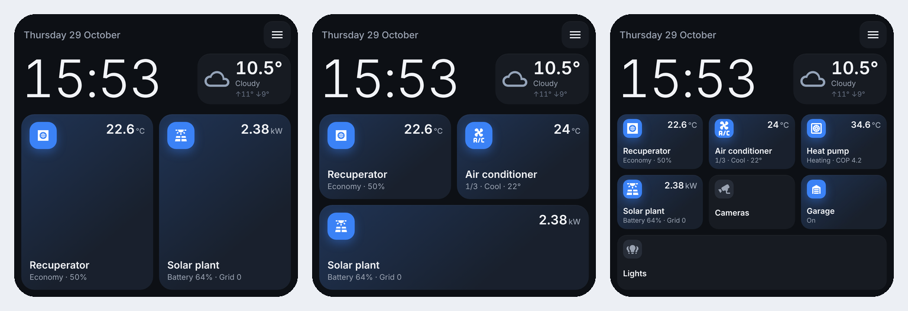
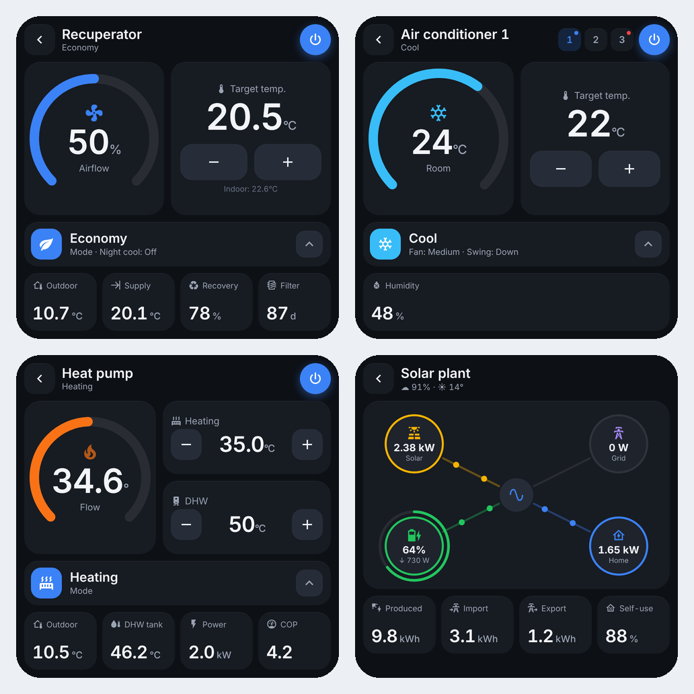
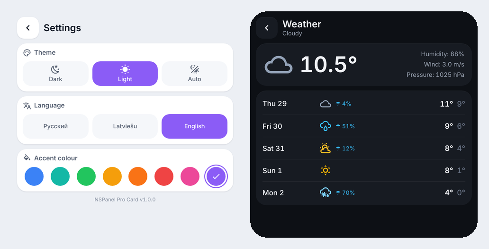
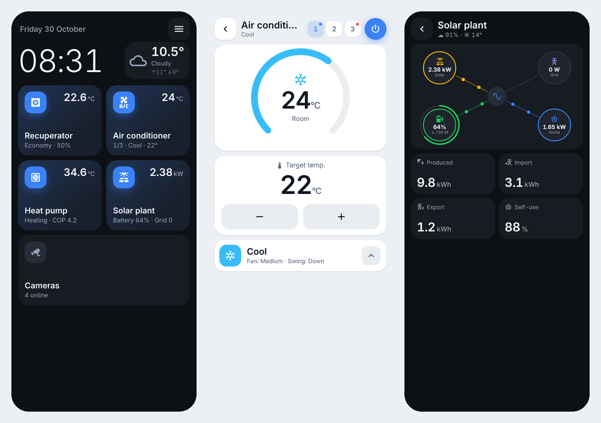

# NSPanel Pro Card

A full-screen smart-home panel for Home Assistant, made for the **Sonoff NSPanel Pro** (480×480) and also usable on a **phone**.
One card gives you a start screen with clock and weather, a settings menu, and control pages for a
recuperator (MVHR ventilation), air conditioners, a heat pump, a solar inverter, plus your own buttons.

Русская версия описания — [ниже](#русский).

## Features

- **Start screen** — big clock, date, current weather (tap it for a 5-day forecast) and one tile per connected device.
- **Only what you have** — every device section can be switched on or off. The number of tiles and their layout adapt automatically (1–12 tiles).
- **Custom buttons** — extra tiles that open another dashboard/view, a URL, an entity's info dialog, or toggle an entity.
- **Two layouts** — `nspanel` (fixed 480×480 layout scaled to the screen) or `phone` (portrait, scrollable).
- **Menu** — dark / light / auto theme, language (Русский, Latviešu, English) and 8 accent colours, changeable right on the panel.
- **Recuperator** — power, modes (protection / economy / comfort / boost), target temperature, airflow ring, all temperatures, recovery efficiency, filter, night cooling.
- **Air conditioners** — any number of `climate` entities with a unit switcher, HVAC modes, fan / swing / preset pickers and extra switches (Gree quiet / xtra fan / fresh air / display are detected automatically).
- **Heat pump** — power, modes (heating / cooling / hot water / auto), heating and DHW set points, flow / return / tank temperatures, compressor, power, COP, energy, quiet / weather-compensation / DHW-boost switches.
- **Solar inverter** — animated power-flow diagram (PV, battery with SoC ring, grid, home) and today's produced / imported / exported energy and self-use. W/kW and Wh/kWh are converted automatically.
- **Visual editor** — everything can be configured in the UI card editor (labels in English, Russian and Latvian).
- Returns to the start screen after a configurable idle time.

| Themes and languages | Adaptive tiles |
|---|---|
|  |  |

| Device pages | Menu and weather |
|---|---|
|  |  |

**Phone layout**

## Installation

### HACS (recommended)

1. HACS → ⋮ → **Custom repositories** → add `https://github.com/keziksdmitrijs-byte/nspanel-pro-card`, type **Dashboard**.
2. Search for **NSPanel Pro Card** and download it.
3. Reload the browser (on the panel: restart the Companion app).

### Manual

Copy `dist/nspanel-pro-card.js` to `/config/www/` and add a dashboard resource
`/local/nspanel-pro-card.js` (type *JavaScript module*).

## Setting up the panel

1. Create a new dashboard (Settings → Dashboards → Add dashboard → *New dashboard from scratch*).
2. Edit it, set the view type to **Panel (single card)** and add the card **NSPanel Pro Card**.
3. In the visual editor choose the **device type**, the weather entity and switch on the sections you have.
4. On the NSPanel Pro (Home Assistant Companion app) log in with the user you want, open the dashboard and make it the default
   dashboard for that device (Profile → *Dashboard*).
5. Optional: hide the header and sidebar for the panel user with [kiosk-mode](https://github.com/NemesisRE/kiosk-mode) — see
   [`examples/nspanel-dashboard.yaml`](examples/nspanel-dashboard.yaml).

## Configuration

Everything below can be set in the visual editor. YAML example: [`examples/nspanel-dashboard.yaml`](examples/nspanel-dashboard.yaml),
phone: [`examples/phone-view.yaml`](examples/phone-view.yaml).

### General

| Option | Default | Description |
|---|---|---|
| `device` | `nspanel` | `nspanel` — fixed 480×480 layout scaled to the screen; `phone` — portrait layout with scrolling |
| `weather` | — | `weather.*` entity for the start screen and forecast page |
| `home_timeout` | `90` (`0` for phone) | Seconds without touches before returning to the start screen (`0` = never) |
| `theme` / `language` / `accent` | `dark` / HA language / `blue` | Initial values. Theme: `dark`, `light`, `auto` (dark after sunset). Language: `ru`, `lv`, `en` |
| `theme_entity` / `language_entity` / `accent_entity` | — | Optional `input_select` helpers to store the menu choice in HA (see [`examples/settings-helpers.yaml`](examples/settings-helpers.yaml)). Without them the choice is kept in the browser of that device |
| `show_settings` | `true` | Show the menu button |
| `height` | auto | Force the card height in px (normally it fills the screen) |

### `recuperator`

| Option | Description |
|---|---|
| `enabled` | `false` hides the device |
| `name` | Tile / page title |
| `power` | `switch` / `input_boolean` |
| `mode` | `select` / `input_select` with the operating modes |
| `mode_protection`, `mode_economy`, `mode_comfort`, `mode_boost` | Option of `mode` that corresponds to each button. Empty = auto-detect by name (RU / LV / EN) |
| `target`, `target_step` | `number` / `input_number` set point and +/- step (default 0.5) |
| `airflow` | Fan level / airflow % — shown in the ring |
| `indoor`, `outdoor`, `supply`, `extract`, `exhaust` | Temperatures |
| `efficiency`, `fan_rpm`, `filter_days` | Heat recovery %, fan speed, days until filter change |
| `night_cooling` | Switch shown as a toggle tile |
| `boost_button`, `boost_remaining` | `button` / `input_button` / `script` for boost and its remaining time in seconds |
| `status`, `error_count`, `error_text` | Shown in the page header |

### `air_conditioner`

| Option | Description |
|---|---|
| `enabled` | `false` hides the device |
| `name` | Tile title |
| `entities` | List of `climate` entities, or objects `{entity, name, short, switches: [...]}` |

Extra switches named `switch.<climate_object_id>_quiet_mode`, `_xtra_fan`, `_fresh_air`, `_panel_light` (Gree integration) are added automatically;
use `switches:` to list your own.

### `heat_pump`

| Option | Description |
|---|---|
| `enabled`, `name` | |
| `power` | `switch` / `input_boolean` |
| `mode` | `select` / `input_select`; `mode_heat`, `mode_cool`, `mode_dhw`, `mode_auto` map options to buttons (empty = auto-detect) |
| `status` | Optional sensor/select with the current state (heating, cooling, DHW, idle, off). Without it the state is derived from mode and compressor |
| `water_target`, `dhw_target` | Set points: `number`, `input_number`, `water_heater` or `climate` (`water_step`, `dhw_step` change the +/- step) |
| `water_out`, `water_in`, `dhw_tank`, `outdoor` | Temperatures (`outdoor` falls back to the weather entity) |
| `compressor`, `electric_power`, `cop`, `energy_today` | Compressor frequency, electric power (W or kW), COP, energy today |
| `quiet`, `weather_comp`, `dhw_boost` | Switches shown as toggle buttons |

### `solar`

| Option | Description |
|---|---|
| `enabled`, `name` | |
| `pv_power`, `load`, `battery_power`, `grid_power` | Power sensors, W or kW |
| `battery_soc` | Battery state of charge, % |
| `energy_today`, `import_today`, `export_today` | Energy sensors, Wh or kWh |
| `battery_invert` | The card expects **+ = charging**. Enable if your inverter reports + when discharging |
| `grid_invert` | The card expects **+ = import from grid**. Enable if your inverter reports + when exporting |

Nodes that have no entity are not drawn.

### `custom_buttons`

A list of extra tiles (the visual editor offers two; YAML allows more).

| Option | Description |
|---|---|
| `name`, `icon`, `subtitle` | Appearance |
| `action` | `navigate`, `url`, `more-info` or `toggle` |
| `navigation_path` | For `navigate`, e.g. `/dashboard-cameras/0` |
| `url`, `new_tab` | For `url` (`new_tab: false` opens in the same window) |
| `entity` | For `more-info` / `toggle`; with other actions its state is shown on the tile |

## Notes

- The card uses `ha-icon`, `ha-form` and other built-in Home Assistant components; Home Assistant 2024.8 or newer is recommended.
- On the NSPanel Pro the Companion app WebView caches resources heavily — after updating the card, restart the app.

---

## Русский

**NSPanel Pro Card** — полноэкранная панель управления умным домом для Home Assistant, сделанная под **Sonoff NSPanel Pro**
(480×480), которую можно использовать и на **телефоне**.

**Что умеет:**

- Стартовый экран: часы, дата, погода (нажатие открывает прогноз на 5 дней) и плитки устройств.
- Выбор того, что подключено: каждый раздел (рекуператор, кондиционеры, тепловой насос, солнечная станция) включается и
  выключается, количество и раскладка плиток подстраиваются автоматически.
- Свои кнопки: переход на другой дашборд или вид, открытие ссылки, карточка сущности или переключение сущности.
- Выбор устройства: `nspanel` (480×480, весь экран) или `phone` (вертикальная раскладка с прокруткой).
- Меню на самой панели: тёмная / светлая / авто тема, язык (русский, латышский, английский), 8 цветов акцента.
- Визуальный редактор с подписями на русском, латышском и английском.

**Установка:** HACS → ⋮ → *Пользовательские репозитории* → `https://github.com/keziksdmitrijs-byte/nspanel-pro-card`,
тип **Dashboard** → скачать **NSPanel Pro Card** → перезагрузить браузер / приложение.

**Настройка:** создайте новый дашборд, тип вида — **Панель (одна карточка)**, добавьте карточку **NSPanel Pro Card** и в
визуальном редакторе выберите тип устройства, погоду и включите нужные разделы, указав сущности. На NSPanel Pro (приложение
Home Assistant Companion) откройте этот дашборд и сделайте его дашбордом по умолчанию для устройства (Профиль → *Дашборд*).
Скрыть шапку и боковое меню для пользователя панели можно через [kiosk-mode](https://github.com/NemesisRE/kiosk-mode).

**Знаки мощности солнечной станции:** карточка ожидает «+» = заряд батареи и «+» = импорт из сети. Если ваш инвертор
показывает наоборот — включите `battery_invert` / `grid_invert`. Ватты и киловатты пересчитываются автоматически.

Хранить выбор темы, языка и цвета в Home Assistant (а не в браузере устройства) можно через хелперы `input_select` —
пример в [`examples/settings-helpers.yaml`](examples/settings-helpers.yaml).

## License

MIT
